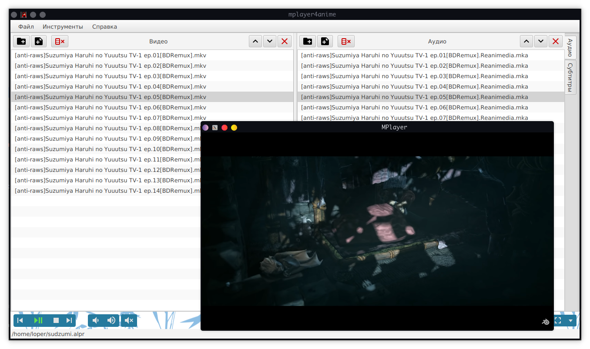

# mplayer4anime

  [](https://ci.redrise.ru/repos/2)

mplayer4anime is mplayer/mpv launcher to play video file with audio layer and/or subtitles (.ass, .srt, etc.) at once.



### Features

* Playlists management: create, open and save playlists (JSON-based `.alpr` format), recently opened playlists are kept
* External audio tracks and subtitles are found automatically in video folders and offered for adding
* Two playback backends: mplayer and mpv (mpv is currently Linux-only), selectable in settings
* Interface languages: English, Russian, Korean

### License

GNU General Public License v.3. You can find it in LICENSE file

### Requirements

For latest versions of this app use JRE or JDK 25 or higher.

For older versions (up to v0.15) please use JRE/JDK 8 or higher (and JavaFX if you're NOT using Windows. For example: in Debian Stretch you should install 'openjfx' package).

### Running on Linux

Install mplayer or mpv, then start the application as a regular Java application:
```
$ java -jar mplayer4anime.jar
```

### Running on Windows

There are two ways to run mplayer4anime on Windows: native installer or executing jar-file

The installer ships its own JRE, so you only need mplayer installed (mpv backend is not supported on Windows yet). When running the jar-file directly you will need JRE/JDK 25 or higher and mplayer installed as well.

### Thanks!

* [DDinghoya](https://github.com/DDinghoya), who translated this application to Korean!
